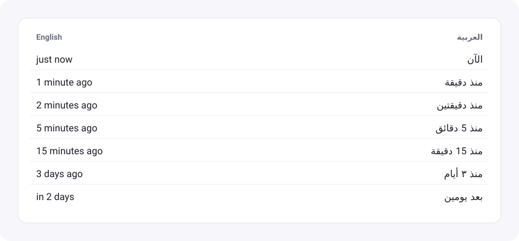

# relative_time_ar

[](https://pub.dev/packages/relative_time_ar)
[](https://github.com/senkop/relative_time_ar/actions/workflows/ci.yml)
[](LICENSE)

Relative time text like "5 minutes ago" for Flutter, in **English and Arabic**, with the Arabic grammar done right. No dependencies.

- English: just now, 1 minute ago, 3 hours ago, in 2 days
- Arabic with correct forms: منذ دقيقة، منذ دقيقتين، منذ 5 دقائق، منذ 15 دقيقة
- Past and future (منذ / بعد, ago / in)
- Optional Arabic-Indic digits: منذ ٥ دقائق
- `RelativeTimeText` widget that refreshes itself
- Pure Dart `RelativeTime.format` you can use anywhere



## Install

```bash
flutter pub add relative_time_ar
```

## Usage

```dart
import 'package:relative_time_ar/relative_time_ar.dart';

RelativeTime.format(sentAt);                                // 5 minutes ago
RelativeTime.format(sentAt, locale: RelativeLocale.ar);     // منذ 5 دقائق
RelativeTime.format(sentAt, locale: RelativeLocale.ar, arabicDigits: true); // منذ ٥ دقائق

// A Text that updates every 30 seconds:
RelativeTimeText(sentAt, locale: RelativeLocale.ar)
```

## Arabic forms

| Count | Minutes | Days |
| --- | --- | --- |
| 1 | منذ دقيقة | منذ يوم |
| 2 | منذ دقيقتين | منذ يومين |
| 3–10 | منذ 5 دقائق | منذ 3 أيام |
| 11+ | منذ 15 دقيقة | منذ 12 يومًا |

## Example

```bash
cd example
flutter create .
flutter run -d chrome
```

## License

MIT
